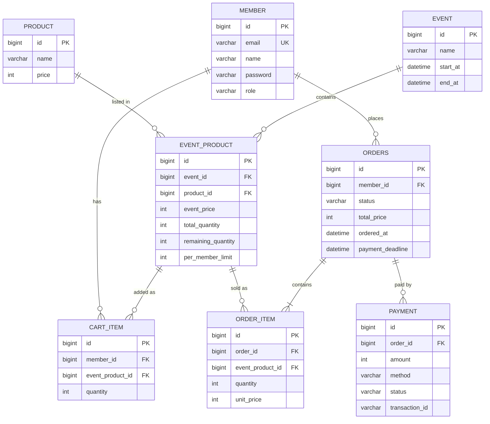

# EventCart 설계 문서

> 선착순 한정 수량 이벤트 쇼핑몰 — Java/Spring 백엔드 포트폴리오용 사이드 프로젝트

## 1. 프로젝트 목표

- **핵심 주제: 동시성 하에서의 재고 정합성.** 수백 명이 동시에 주문해도 재고가 음수가 되거나 1인 구매 제한을 넘지 않도록 보장한다.
- SI 실무에서 익숙한 계층형 구조(Controller → Service → Repository)를 유지하면서, 도메인 모델·트랜잭션·락 전략·테스트를 단계적으로 고도화한다.
- 단계별로 "문제 → 해결 → 측정" 기록을 남겨 블로그/면접 자료로 쓴다.

## 2. 기술 스택

| 구분 | 선택 | 비고 |
|---|---|---|
| Language | Java 21 | record, switch 패턴 등 |
| Framework | Spring Boot 3.5.8 | Web, Data JPA, Validation, Security, Data Redis |
| DB | MySQL 8 (로컬: docker compose) | 테스트도 MySQL 8 (Testcontainers) |
| Cache | Redis 7 | 재고 게이트 (4단계) |
| Build | Gradle (Groovy DSL) | |
| Test | JUnit 5, AssertJ, SpringBootTest, Testcontainers | 동시성 테스트, 실제 MySQL·Redis |
| 부하 테스트 | k6 + GitHub Actions | [LOAD_TEST.md](LOAD_TEST.md) |
| 배포·운영 | Docker, compose, GHCR, Actuator, Prometheus, Grafana | 7단계 |

## 3. 요구사항

### 기능 요구사항

| ID | 기능 | 설명 |
|---|---|---|
| F-01 | 회원 등록·로그인 | 이메일·이름·비밀번호로 가입(USER), 로그인 시 JWT 발급. 관리자는 설정값으로 생성 |
| F-02 | 상품 관리 | 상품 등록·조회 (정가) |
| F-03 | 이벤트 관리 | 기간(시작~종료)이 있는 이벤트 생성, 이벤트에 상품을 이벤트가·한정 수량·1인 구매 제한과 함께 등록 |
| F-04 | 이벤트 조회 | 진행 중 이벤트 목록, 이벤트 상품별 남은 수량 |
| F-05 | 장바구니 | 이벤트 상품 담기/수량 변경/삭제/조회. **담기만으로 재고를 점유하지 않음** |
| F-06 | 주문 | 장바구니 전체 주문 또는 바로 구매. 주문 시점에 재고 차감 (선착순) |
| F-07 | 주문 취소 | 취소 시 재고 복구, 결제 완료 주문은 환불 |
| F-09 | 결제 | 주문 후 결제 기한(10분) 안에 결제. 모의 PG 연동, 거절 시 재시도 가능 |
| F-10 | 미결제 자동 만료 | 결제 기한이 지난 주문은 스케줄러가 만료시키고 재고 반납 |
| F-08 | 주문 조회 | 내 주문 목록/상세 |

### 비즈니스 규칙

1. 이벤트 기간 밖에서는 장바구니 담기·주문 불가
2. 재고(`remaining_quantity`)는 0 미만이 될 수 없다
3. 회원별 누적 구매 수량(결제 대기·결제 완료 주문만)은 `per_member_limit`을 넘을 수 없다
4. 장바구니 주문은 **전부 성공 또는 전부 실패** (한 트랜잭션)
5. 주문 성공 시 해당 장바구니 항목 삭제
6. 주문 시점에 재고를 차감하고, 결제 기한 안에 결제하지 않으면 만료되어 재고가 돌아온다

### 비기능 요구사항

- 동시 주문 100건 이상에서 초과 판매 0건 (테스트로 증명)
- 일관된 에러 응답 포맷 (`code`, `message`)

## 4. ERD



- `cart_item (member_id, event_product_id)` 유니크 — 같은 상품을 다시 담으면 수량 합산
- 모든 테이블에 `created_at`, `updated_at` (JPA Auditing)
- 주문 테이블명은 예약어 회피를 위해 `orders`

## 5. API 설계

공통: `Content-Type: application/json`, 회원 식별은 `Authorization: Bearer <JWT>` (2단계)

| Method | URI | 설명 |
|---|---|---|
| POST | `/api/members` | 회원가입 |
| POST | `/api/auth/login` | 로그인 → 액세스 토큰 |
| POST | `/api/products` | 상품 등록 |
| GET | `/api/products/{id}` | 상품 조회 |
| POST | `/api/events` | 이벤트 생성 |
| POST | `/api/events/{eventId}/products` | 이벤트에 상품 등록 |
| GET | `/api/events/ongoing` | 진행 중 이벤트 목록 (상품·남은 수량 포함) |
| GET | `/api/events/{eventId}` | 이벤트 상세 |
| GET | `/api/cart` | 내 장바구니 |
| POST | `/api/cart/items` | 담기 `{eventProductId, quantity}` |
| PATCH | `/api/cart/items/{cartItemId}` | 수량 변경 `{quantity}` |
| DELETE | `/api/cart/items/{cartItemId}` | 삭제 |
| POST | `/api/orders/checkout` | 장바구니 전체 주문 |
| POST | `/api/orders` | 바로 구매 `{eventProductId, quantity}` |
| GET | `/api/orders` | 내 주문 목록 |
| GET | `/api/orders/{orderId}` | 주문 상세 |
| POST | `/api/orders/{orderId}/payment` | 결제 `{method}` (모의 PG: `DECLINED_CARD`면 거절) |
| POST | `/api/orders/{orderId}/cancel` | 주문 취소 (결제 완료면 환불) |

에러 응답 예:

```json
{ "code": "OUT_OF_STOCK", "message": "재고가 부족합니다." }
```

| code | HTTP | 의미 |
|---|---|---|
| `MEMBER_NOT_FOUND` 등 `*_NOT_FOUND` | 404 | 리소스 없음 |
| `OUT_OF_STOCK` | 409 | 재고 부족 |
| `PURCHASE_LIMIT_EXCEEDED` | 409 | 1인 구매 제한 초과 |
| `EVENT_NOT_ONGOING` | 400 | 이벤트 기간 아님 |
| `CART_EMPTY` | 400 | 빈 장바구니 주문 |
| `INVALID_ORDER_STATUS` | 400 | 현재 상태에서 불가 (이미 결제·만료·취소) |
| `PAYMENT_EXPIRED` | 400 | 결제 기한 지남 |
| `INVALID_INPUT` | 400 | 검증 실패 |
| `UNAUTHORIZED` | 401 | 토큰 없음·위조·만료 |
| `INVALID_CREDENTIALS` | 401 | 이메일 또는 비밀번호 불일치 |
| `FORBIDDEN` | 403 | 권한 부족 (관리자 전용 API) |

## 6. 주문·결제 상태

```
PENDING_PAYMENT ──결제 승인──▶ PAID ──취소(환불)──▶ CANCELED
      ├──────────취소───────────────────────────▶ CANCELED
      └──결제 기한 지남 (스케줄러, 30초마다)──▶ EXPIRED
```

- 재고는 주문 시점에 차감한다(선착순). CANCELED·EXPIRED가 되면 DB와 Redis 재고를 돌려준다.
- 결제·취소·만료는 모두 **주문 행을 먼저 잠그고 상태를 다시 확인**한다. 결제와 만료가 동시에 와도 한쪽만 반영된다 (`PaymentFlowTest`에서 10회 반복 검증).
- 결제 거절은 예외가 아니다. `FAILED` 결제 기록을 남기고 주문은 결제 대기로 둔다.
- PG는 `PaymentGateway` 인터페이스 뒤에 숨긴다. 지금은 `FakePaymentGateway`.
- 한계와 다음 단계
  - 모의 PG라 주문 락을 쥔 채 PG를 호출한다. 실제 PG(수 초 소요)는 `PAYING` 상태로 먼저 커밋하고 트랜잭션 밖에서 호출, 결과를 웹훅·조회로 확정해야 한다.
  - 서버가 여러 대면 스케줄러가 모두 돈다(중복 처리는 락으로 막힘). ShedLock으로 한 대만 돌게 하는 것이 좋다.

## 7. 동시성 전략

### 1단계 (현재 구현): DB 비관적 락

```
주문 트랜잭션 시작
  └─ SELECT ... FROM event_product WHERE id IN (...) ORDER BY id FOR UPDATE
  └─ 회원 누적 구매 수량 조회 → 1인 제한 검증
  └─ 남은 수량 검증 → 차감 (dirty checking)
  └─ 주문/주문상품 저장, 장바구니 삭제
커밋 (락 해제)
```

- 재고 검증과 1인 제한 검증을 **같은 락 안에서** 처리해야 두 규칙 모두 지켜진다. (재고만 원자적 UPDATE로 막으면 같은 회원의 동시 요청이 1인 제한을 뚫을 수 있음)
- 여러 상품을 한 번에 주문할 때 **id 오름차순으로 락**을 잡아 데드락을 피한다.
- 주문 트랜잭션은 **READ_COMMITTED**. MySQL 기본값 REPEATABLE_READ에서는 락을 기다린 뒤 실행하는 일반 SELECT(누적 구매 수량)가 트랜잭션 초기 스냅샷을 읽어 1인 제한이 뚫릴 수 있다.
- 락 조회 전에 `EventProduct`를 영속성 컨텍스트에 올리지 않는다(장바구니는 id·수량만 projection 조회). 이미 로딩된 엔티티는 `FOR UPDATE` 조회 후에도 1차 캐시의 오래된 값이 남는다.
- `event`를 join fetch하지 않는다. 조인하면 이벤트 행까지 잠겨 같은 이벤트의 모든 주문이 직렬화된다.
- 주문 취소는 주문 행도 잠가 중복 취소로 재고가 두 번 복구되는 것을 막는다.
- 장점: 단순, 정확. 단점: 인기 상품 한 행에 요청이 몰리면 대기 → 처리량 한계.
- 측정(3단계): 상품 1개 집중 시 약 110~126건/초, p95 약 1.5초. 10개 분산 시 약 2.1~2.5배 빠름. 품절 요청도 락을 기다린다. → [LOAD_TEST.md](LOAD_TEST.md)

### 이후 비교 대상

| 방식 | 내용 | 기록할 것 |
|---|---|---|
| 낙관적 락 (`@Version`) | 충돌 시 재시도 | 충돌률 높을 때 성능 저하 |
| 원자적 UPDATE | `UPDATE ... SET remaining = remaining - ? WHERE remaining >= ?` | 1인 제한은 별도 처리 필요 |
| **Redis Lua 게이트 (4단계 구현)** | DB 앞단에서 재고·1인 제한 선확인 | DB-Redis 정합성, 보상 처리 |
| Redisson 분산 락 | 다중 인스턴스 | 락 획득 대기 시간 |
| 대기열 (Redis Sorted Set) | 트래픽 제어 | 사용자 경험 |

### 2단계 (4단계 구현): Redis 재고 게이트 + DB 최종 검증

```
OrderFacade (트랜잭션 없음)
  ├─ Redis Lua: 1인 제한·재고 확인 후 예약 ──실패──▶ 409 즉시 응답 (DB 접근 없음)
  ├─ OrderService (트랜잭션): 위 1단계 흐름 그대로 (비관적 락, 최종 검증)
  └─ DB 실패 시 Redis 예약 반납 (보상)
취소: DB 취소 확정 후 Redis 반납
```

- **DB가 최종 기준.** Redis가 틀려도 초과 판매는 DB 락이 막는다. Redis가 틀릴 수 있는 방향은 "덜 팔림"뿐(반납 실패 등)이다.
- 키: `{prefix}:{event-product:ID}`(stock, limit, name 해시) + `...:buyers`(회원별 구매 수량). 해시 태그로 Cluster에서도 같은 슬롯.
- 초기화: 이벤트 상품 등록 커밋 직후 미리 채움. 키가 없으면(Redis 재시작) 주문 시 DB에서 남은 재고·회원별 구매 수량을 읽어 지연 초기화.
- 반납은 트랜잭션이 끝난 뒤(롤백 포함)에 한다. 롤백 전에 반납하면 그 재고를 다른 요청이 먼저 예약할 수 있다.
- 남은 과제: Redis와 DB 재고를 주기적으로 맞추는 대사(reconciliation) 작업, 반납 실패 재시도.

## 8. 배포·모니터링 (7단계)

```
[외부] ──8080──▶ app ──▶ MySQL, Redis          (내부망)
                  └─8081 /actuator/prometheus ◀── Prometheus (5초마다) ◀── Grafana ◀──3000── [외부]
```

- 이미지: 멀티스테이지 빌드, Spring Boot 레이어 분리(의존성/코드), root 아닌 사용자, `prod` 프로필.
- 비밀값(DB 비밀번호, JWT_SECRET)은 `.env` → 환경변수. `prod`에는 기본값이 없어 빠지면 기동 실패.
- 관리 포트(8081)는 외부에 열지 않는다. 헬스체크 `/actuator/health/liveness`, `/readiness`.
- 비즈니스 지표 `eventcart_orders_total{result, stage}`: stage=gate 비율로 Redis 게이트 효과를 본다. 태그 값은 고정 목록만 쓴다.
- 검증: PR마다 Deploy check 워크플로가 스택 기동 → k6(회원 300, 재고 100) → Prometheus에서 성공 100·품절 200 확인 → Grafana 대시보드·데이터소스 확인. 첫 실행 결과: 품절 200건 모두 Redis에서 거절, 주문 API p95 약 0.86초.
- 남은 과제: HTTPS(Nginx/Caddy 리버스 프록시), Flyway 스키마 관리, 알림(Grafana Alerting), 클라우드(AWS/NCP) 서버 배포 자동화.

## 9. 패키지 구조

```
com.eventcart
 ├─ common      (BaseTimeEntity, 예외·에러코드, 전역 예외 처리)
 ├─ auth        (SecurityConfig, JWT 발급·검증 필터, 로그인, 관리자 초기화)
 ├─ member
 ├─ product
 ├─ event       (Event, EventProduct)
 ├─ cart
 ├─ order       (Order, OrderItem, OrderService ← 동시성 핵심, OrderFacade, stock/StockGate ← Redis, 만료 스케줄러)
 └─ payment     (Payment, PaymentService, gateway/PaymentGateway ← 모의 PG)
```

도메인별 패키지 안에 `controller / service / repository / domain / dto`를 둔다.

## 10. 로드맵

| 단계 | 내용 | 산출물 |
|---|---|---|
| 1 (완료) | 도메인·API·비관적 락 주문, 동시성 테스트 | 초기 코드, 본 문서 |
| 2 (완료) | Spring Security + JWT, 관리자/사용자 권한 분리 | `X-Member-Id` 제거, AuthApiTest |
| 3 (완료) | k6 부하 테스트로 비관적 락 기준치 측정 (hot vs spread) | [LOAD_TEST.md](LOAD_TEST.md) |
| 4 (완료) | Redis 재고 게이트 (Lua 원자 예약 + 실패 시 반납) | [LOAD_TEST.md](LOAD_TEST.md) 전후 비교 |
| 5 (완료) | Testcontainers(MySQL·Redis), GitHub Actions CI | 통합 테스트가 실제 MySQL 8·Redis에서 실행 |
| 6 (완료) | 결제 모의 연동 + 미결제 주문 자동 만료(스케줄러) | 주문 상태 머신, PaymentFlowTest |
| 7 (완료) | Docker 배포 스택, 모니터링 (Actuator + Prometheus/Grafana), GHCR 이미지 | Deploy check 워크플로 |

### 이후 개선 후보

| 우선순위 | 과제 | 이유 |
|---|---|---|
| 1 | 실제 서버 배포 (AWS Lightsail/EC2, NCP) + HTTPS | 포트폴리오에 접속 가능한 주소 |
| 2 | 성공 주문 대기 줄이기 (락 안 조회 축소, 원자적 UPDATE, 또는 대기열 비동기 처리) | 부하 테스트에서 성공 p95 1.5~2.5초 |
| 3 | 실제 PG 연동 구조 (`PAYING` 상태, 웹훅, 멱등 키) | 락 안에서 외부 호출 제거 |
| 4 | Flyway, ShedLock, Redis-DB 재고 대사 작업 | 운영 안정성 |
